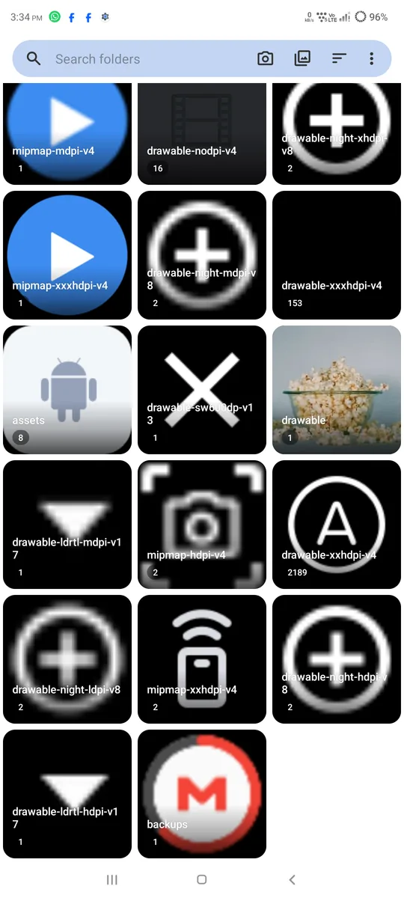
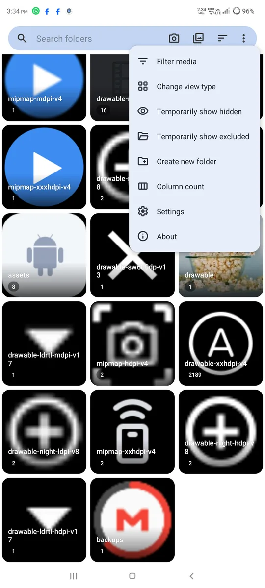
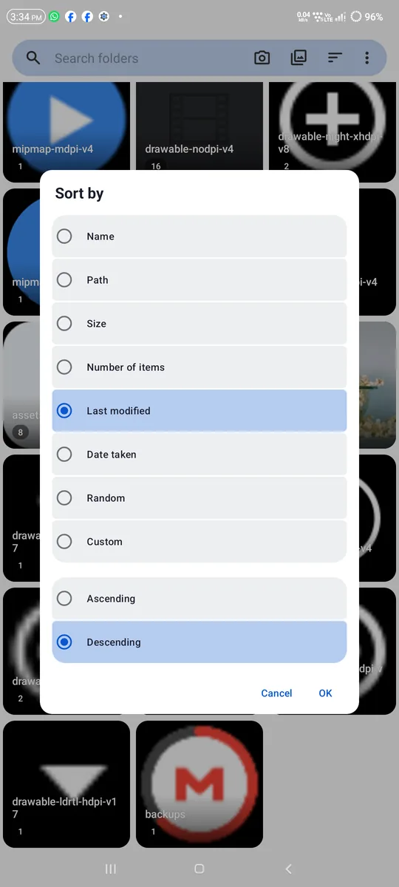
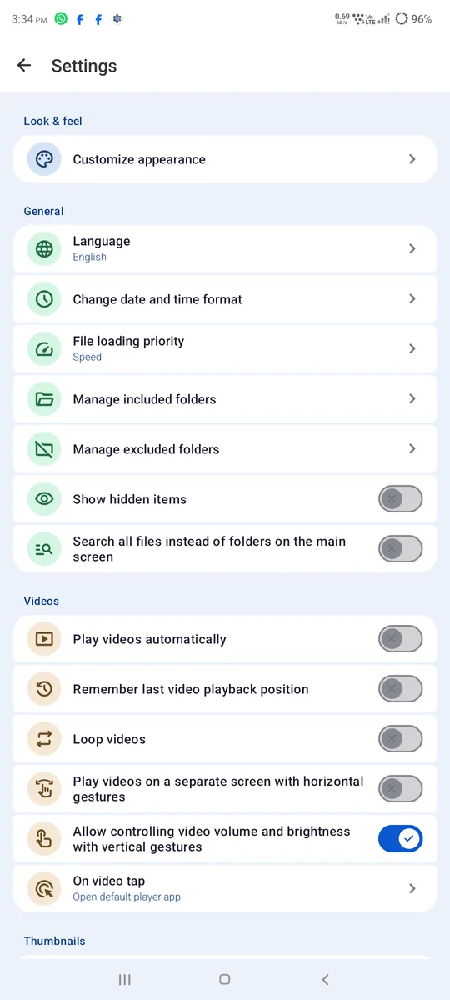
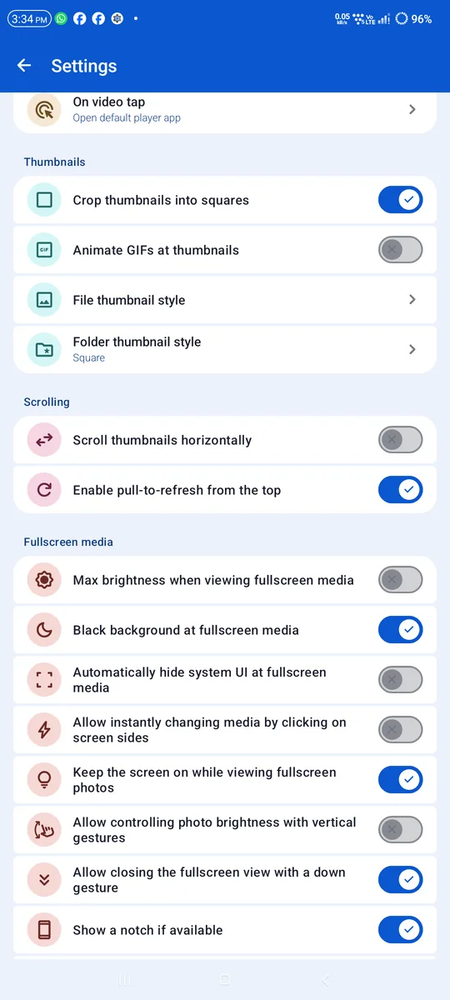
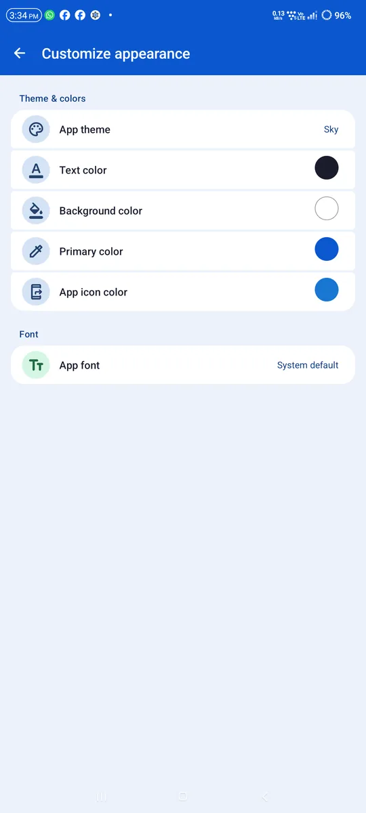
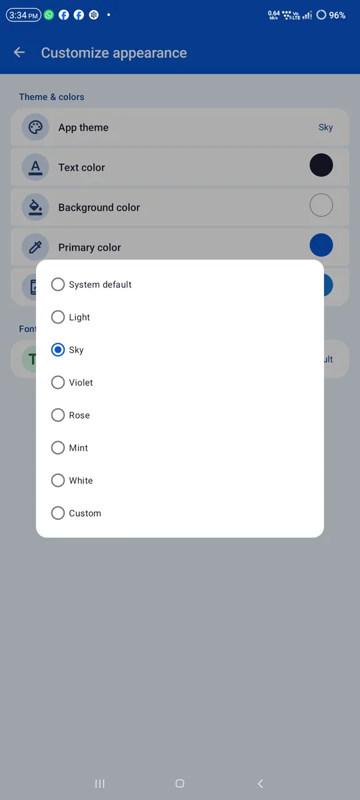

<div align="center">


# Gallery

A fast, private and customizable gallery for Android.<br>
No ads, no trackers, no network access.

[](https://github.com/BlazeFTL/Gallery/releases)
[](LICENSE)
[](#download)

</div>

Gallery is a fork of [Fossify Gallery](https://github.com/FossifyOrg/Gallery), which is itself based on [Simple Gallery](https://github.com/SimpleMobileTools/Simple-Gallery). The upstream project rarely receives updates, so this fork carries its own design, fixes and features.

## Screenshots

<div align="center">









</div>

## What is different in this fork

- Design updates across the app
- Updated icons, with a Gallery icon (default) and a Monochrome icon that never change with the theme colors
- Albums show up at once when the app opens, new and removed photos and folders are picked up right away
- Album title shown under the album cover
- 5 more app icons
- Custom themes
- Fixed a delete bug, deleting is instant and an interrupted delete is finished on the next start
- Redesigned About page
- Build workflow that outputs direct APKs, split by architecture

## Features

- Photo editor: crop, resize, rotate, flip, draw and apply filters
- Privacy tools: strip EXIF metadata such as GPS coordinates and camera details
- Security: lock the whole app, hidden items, excluded folders or file deletion with a PIN, pattern or fingerprint
- Recycle bin to recover deleted photos and videos
- Wide format support: JPEG, JPEG XL, PNG, GIF, WebP, AVIF, APNG, SVG, RAW, MP4, MKV and more
- Hide, exclude and include folders, pin albums, group and sort media
- Material design with dynamic and custom themes, configurable buttons and thumbnails

## Download

Get the latest APK from the [Releases](https://github.com/BlazeFTL/Gallery/releases) page. Every release asset is a direct APK, there is nothing to unzip. The package name is `com.blazeftl.gallery` (`com.blazeftl.gallery.debug` for debug builds), so it installs next to the original Fossify Gallery.

| File ends with | Use it on |
| --- | --- |
| `arm64-v8a` | Almost all phones made in the last years |
| `armeabi-v7a` | Older 32-bit ARM phones |
| `x86_64`, `x86` | Emulators and some tablets or Chromebooks |
| `universal` | Any device, larger file |

Not sure which one to pick? Use `universal`, or `arm64-v8a` on a modern phone.

## Building

### GitHub Actions

Run the **Build APK** workflow from the Actions tab and pick your options.

| Option | Description |
| --- | --- |
| Flavor | `foss` or `gplay` |
| Build type | `release` is signed with a stable CI key, `debug` installs as a separate `.debug` app |
| Architecture | `all` builds one APK per architecture plus a universal APK. Pick a single architecture or `universal` to build just that |
| R8 | Code shrinking, optimization and obfuscation (release only) |
| Shrink resources | Removes unused resources, needs R8 (release only) |
| Image optimization | PNG crunching (release only) |
| Upload artifacts | Attaches each APK to the run as an unzipped download |
| Publish release | Publishes the APKs as a pre-release |

### Locally

```
./gradlew assembleFossRelease
```

The same options are available as Gradle properties:

```
./gradlew assembleFossRelease \
    -PABI_SPLITS=true \
    -PABI_LIST=arm64-v8a,armeabi-v7a \
    -PUNIVERSAL_APK=false \
    -PENABLE_R8=true \
    -PSHRINK_RESOURCES=true \
    -PCRUNCH_PNGS=true
```

| Property | Default | Description |
| --- | --- | --- |
| `ABI_SPLITS` | `false` | Build one APK per architecture |
| `ABI_LIST` | all four | Comma separated list of architectures to build |
| `UNIVERSAL_APK` | `true` | Also build a universal APK when splitting |
| `ENABLE_R8` | `true` | R8 for release builds |
| `SHRINK_RESOURCES` | `true` | Resource shrinking, ignored when R8 is off |
| `CRUNCH_PNGS` | `true` | PNG crunching for release builds |

Signing uses `keystore.properties` (see `keystore.properties_sample`) or the `SIGNING_*` environment variables.

## Credits

Gallery builds on the work of the [Simple Gallery](https://github.com/SimpleMobileTools/Simple-Gallery) and [Fossify Gallery](https://github.com/FossifyOrg/Gallery) authors. The full list of libraries is in the app, under About, Open-source libraries.

## License

Gallery is licensed under the [GNU General Public License v3.0](LICENSE).
